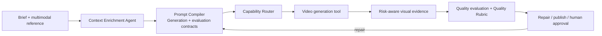

# Video Control Loop Agent

English | [中文](README_CN.md)

> An AI-video quality-control Agent that turns a creative brief into a verifiable control plan, then uses video evidence to decide whether to repair, publish, or request human approval.

## Problem

Users should be able to start with a short creative intention and optional reference assets. The difficult part is reliably carrying that brief through creative development, shot planning, multimodal constraint management, generation, evidence collection, quality judgement, and targeted iteration. Manually coordinating this loop is costly, hard to audit, and does not reliably determine whether the next step should be generation, repair, publication, or a human handoff.

This project lets a budget-, evidence-, and capability-bounded Agent run that loop on the user's behalf. The user intervenes only to supply material context, change constraints, or authorise additional iteration.

This project implements the following loop:

`creative brief → control plan → video generation → risk-aware evidence → Quality Rubric → Bad Case → repair / publish`

## What this demo demonstrates

| Video Agent PM capability | Implementation in this demo |
|---|---|
| Generation controllability | Turns a brief into a scene-specific 1–6 beat plan, immutable constraints, risk forecast, and atomic acceptance criteria; diagnoses a target beat, then regenerates a new complete clip with passed requirements preserved. |
| Multimodal asset governance | Keeps an ordered Asset Manifest for images/audio and explicit `@` bindings; only an explicitly bound image can support a reference-specific visual criterion. |
| Prompt engineering and task decomposition | `Prompt Compiler` creates traceable generation and evaluation contracts from the same control plan. |
| Quality Rubric and Bad Case governance | Critical requirements need frame-cited evidence; a diagnostic score cannot override a critical failure or blocking Bad Case. |
| Autonomous planning and tool use | Context Agent invokes allow-listed calendar, reference observation, and capability-routing tools only when material. |
| Human–Agent collaboration | The user controls repair budget; the Agent may operate within it and must stop for a release gate, missing evidence, exhausted budget, or user pause. |
| Auditable iteration | Each version retains its contracts, evidence, decision, rejected alternatives, and immutable evaluation history. |

## Why this is an Agent, not a fixed workflow

| Fixed workflow | This Agent |
|---|---|
| Calls models in a preset order | Selects a valid generation route from the brief, assets, and declared capabilities |
| Uses fixed frames or one aggregate score | Samples evidence according to planned shots and controllability risks |
| Regenerates the entire video after failure | Chooses the smallest evidence-backed change set and complete-clip regeneration priority |
| Ends at a preset retry count | Stops or continues at release, budget, evidence, and human-approval boundaries |

LLMs plan and explain. Policy code owns evidence validity, release gates, budget, and state transitions.

## Agent loop



1. **Context Enrichment** asks for or observes additional context only when it affects controllability.
2. **Prompt Compiler** binds generation and evaluation to the same approved plan through trace IDs.
3. **Capability Router** sends reference pixels only to an explicitly declared reference-capable endpoint; it never guesses a provider capability.
4. **Asset Manifest** carries attachment order, role, and `@` bindings into both contracts; an uploaded-but-unbound image cannot become reference-comparison evidence.
5. **Quality Agent** samples risk-aware frames and evaluates atomic criteria with cited evidence; audio gates activate only when the approved brief makes audio material.
6. **Repair Planner** selects a permitted change set within the approved budget and records its reasoning and rejected alternatives. With the current providers, execution is a new complete clip—not a hidden local shot edit.

## Release gate

A version is publishable only when:

- every critical acceptance criterion has valid cited frame evidence and passes;
- every active visual-rubric dimension reaches its `3.0` floor;
- when the brief explicitly activates audio requirements, every active audio criterion has valid time-cited evidence and passes;
- no blocking Bad Case remains.

`insufficient_evidence` never becomes a pass or an unsupported repair task. The weighted score is diagnostic only.

## Model and engineering boundary

The Agent control loop is separated from video-provider adapters. Planning, Quality Rubric, version memory, budget policy, and repair logic do not depend on a model ID. A new provider is added by declaring and validating its capabilities.

The current Seedance 1.0 Pro adapter is `test_only`, not a product recommendation. It never receives reference-image pixels by assumption. The project also includes an asynchronous adapter for MiniMax H3 V2. It uses the documented multimodal `content` array: text plus user attachments in order—up to nine `reference_image` items and three `reference_audio` items in this MVP. Multimodal references are not misrepresented as first-frame inputs and are never mixed with first/last-frame modes.

## Run locally

```bash
python3 run_demo.py
```

Open [http://127.0.0.1:8000](http://127.0.0.1:8000). Optional local configuration is described in [.env.example](.env.example). Never commit `.env` or API keys.

To enable MiniMax H3, add the following to `.env`:

```dotenv
VIDEO_PROVIDER=minimax_h3
MINIMAX_API_KEY=your_MiniMax_API_key
MINIMAX_VIDEO_MODEL=MiniMax-H3
MINIMAX_VIDEO_RESOLUTION=768P
```

The H3 V2 adapter submits an asynchronous task, polls its status, downloads the completed video, then returns to the existing evidence and quality loop. It submits the approved 4–15 second duration, ratio, and resolution to H3. If a plan is incompatible with the declared adapter boundary, the Agent reports it before submission rather than silently changing the approved duration.

## Demo and design docs

- [5-minute demo script](docs/interview-demo-script.md)
- [Architecture and state flow](docs/architecture.md)
- [Multimodal Quality Rubric v1.2](docs/video_quality_rubric_v1_2.md)
- [Agent decision policy](docs/agent-decision-policy.md)
- [Real-video acceptance plan](docs/real-video-acceptance-plan.md)

## Current limits and next validation work

- Rubric v1.2 specifies conditional audio, ASR, audio-visual alignment, and lip-sync gates; the current runtime executes local audio-track presence/duration observation, while ASR, alignment, and lip-sync remain future tools.
- Every provider endpoint must be capability-validated before accepting image, video, or audio inputs.
- Next: validate three real-video cases—brand/product integrity, character continuity, and action/narrative completion.

## Public trial deployment

[体验码、30 秒额度、锁定规则与部署说明](docs/public-demo-deployment.md)。体验码由作者在服务器设置为四位数字；不要在前端或仓库中保存体验码或 API Key。
