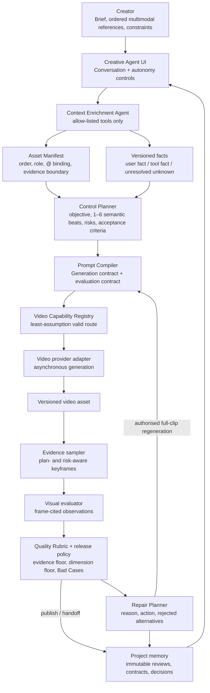
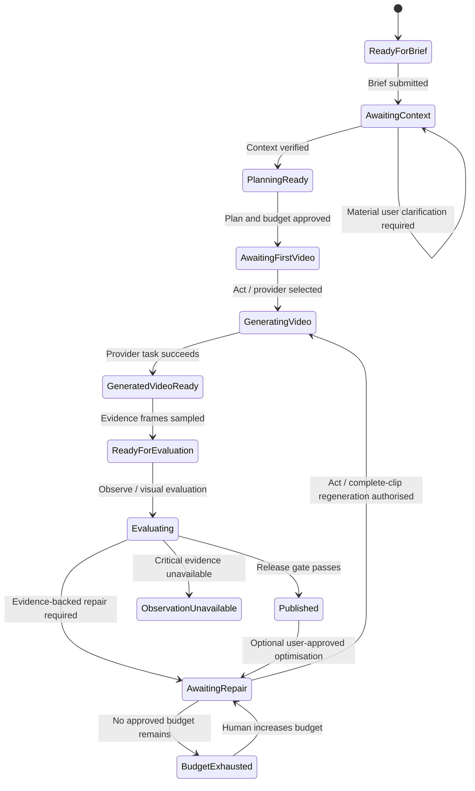
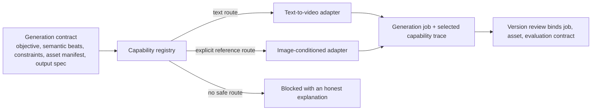

# Architecture and State Flow

## 1. Product boundary

The application has one narrow goal: help a creator decide whether an AI-generated video satisfies an approved brief, then select the smallest justified next action before another generation attempt is spent.

It does not claim to be a universal video editor, trend engine, or model benchmark.

## 2. Runtime architecture

## 3. Responsibility split

| Layer | Decides | Must not decide |
|---|---|---|
| Context Enrichment Agent | Whether allow-listed context tools are materially useful; whether a missing field needs clarification | Invent seasonal, visual, or trend facts |
| Asset Manifest | Preserve user asset order, declared role, and explicit `@` bindings across contracts | Claim image/audio content or turn an unbound upload into an evaluation requirement |
| Control Planner | 1–6 semantic beats, risks, acceptance criteria, recommended repair budget | Override policy or create undisclosed external facts |
| Prompt Compiler | Traceable generation/evaluation contracts and risk-aware sampling policy | Change user-approved immutable constraints silently |
| Capability Registry | Which explicitly declared provider route is valid | Guess that a model supports reference, audio, video editing, or any undocumented task mode |
| Visual evaluator | Observations and cited frame evidence | Publish a version without cited evidence |
| Repair Planner | Rank Bad Cases, select a complete-clip regeneration priority, explain alternatives | Promise provider-side local shot editing, exceed budget, or relax release policy |
| Policy code | Evidence validity, quality gate, budget and state transitions | Generate subjective creative facts |

## 4. Reason–Act–Observe loop

## 5. Model-agnostic adapter contract

The registry is intentionally conservative. An attached image is not proof that the configured provider accepts reference pixels. The Asset Manifest additionally distinguishes *conditioning-only* uploads from images explicitly bound with `@` to an acceptance criterion; only the latter are eligible for reference-specific visual comparison. This prevents a visually impressive but invalid request path from being mistaken for Agent intelligence.

## 6. What is persisted in project memory

- submitted brief and the Asset Manifest (ordered asset metadata, declared role, and explicit `@` bindings);
- completed context-tool observations and unresolved questions;
- control-plan, generation-contract, and evaluation-contract identifiers;
- provider route, model/endpoint identifier, capability profile, and rejected route;
- immutable version reviews, evidence-backed evaluation reports, Bad Cases, decisions, and full-clip regeneration tasks;
- budget changes, human approvals, and autonomy pause/resume events.

The UI presents these as an expandable execution trace and detailed decision log. It never exposes a fabricated hidden chain of thought.
