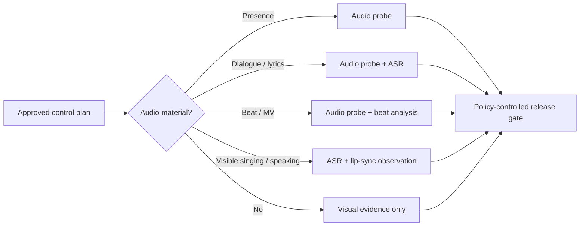

# Video Quality Rubric v1.2 — Multimodal Quality Gate Specification

This specification extends the visual-only v1.1 rubric. It defines when audio becomes part of a release decision, which evidence is required, and how an Agent should select the smallest valid repair. It does **not** claim that the current demo has already implemented ASR, beat analysis, or lip-sync observation.

## 1. Decision boundary

The Agent must first decide whether audio is material to the approved creative plan. Audio is not a universal sixth score: a silent product turntable should not fail because it has no music, while an MV must not pass from attractive frames alone.

| Audio trigger in the approved brief or control plan | Audio gate | Required evidence mode |
|---|---|---|
| No sound, music, dialogue, lyrics, rhythm, or audio reference requirement | Disabled | None |
| Uploaded audio reference; requested BGM, ambience, mood, or sound effect | Active | Audio-track inspection + temporal audio/visual evidence |
| Dialogue, voice-over, spoken brand line, lyrics, or required wording | Critical | Audio-track inspection + ASR transcript comparison |
| Singing, speaking close-up, lip-sync, dubbing, or a named speaker | Critical | ASR / speaker evidence + lip-sync observation |
| MV, beat, rhythm, cut-on-beat, choreography, or sync requirement | Critical where specified | Beat/onset timeline + video-event alignment |

The control plan records the decision as `audio_evaluation_mode = disabled | presence | semantic | sync`. The mode is immutable for a version, stored in the evaluation contract, and shown in the audit log.

## 2. Release gate

A version is publishable only when all applicable conditions pass:

1. Every critical visual acceptance criterion has valid, frame-cited evidence and passes.
2. Every active visual diagnostic dimension reaches its configured floor (currently `3.0`).
3. Every **activated** audio acceptance criterion has valid time-cited evidence and passes.
4. No visual or audio Blocking Bad Case remains.

`disabled` audio criteria are omitted from both the score and release decision. `insufficient_evidence` must never be converted into an audio pass, an assumed transcript, or an unsupported repair task.

## 3. Evidence contract

Audio evidence is time-based and must identify its source. The minimum evidence payload is:

```json
{
  "requirement_id": "s2_tagline_exact",
  "status": "pass|fail|insufficient_evidence",
  "observed": "The spoken tagline is audible once at 00:04.10–00:05.62.",
  "evidence": [
    {
      "source": "asr",
      "start_seconds": 4.1,
      "end_seconds": 5.62,
      "description": "Transcript: 'Open your day with ...'"
    }
  ],
  "repair_hint": "Regenerate the VO segment with the approved tagline."
}
```

Valid evidence sources are:

- `audio_probe`: stream presence, codec, duration, silence spans, clipping / loudness diagnostics.
- `asr`: timestamped transcript for dialogue, lyrics, and voice-over requirements.
- `beat_analysis`: timestamped beats or onsets for rhythm, music-video, and cut-sync requirements.
- `lip_sync_observation`: timestamped visual observation for a visible named speaking/singing subject.
- `frame`: ordinary visual evidence, only when the requirement is visually observable.

The policy layer rejects an audio pass/fail without a known time range and compatible source. For example, a frame cannot prove lyric accuracy, and ASR alone cannot prove lip-sync.

## 4. Active audio dimensions

Audio dimensions are **conditional diagnostics**, not default inputs to the visual overall score.

| Dimension | Activate when | What it measures | Default floor |
|---|---|---|---|
| `audio_presence_integrity` | Any required audio exists | Track present, expected coverage, no material silent gap / severe clipping | 3.0 |
| `speech_lyric_fidelity` | Required dialogue, lyrics, or VO | Required wording, speaker/turn order when specified | 3.0; critical exact wording blocks release |
| `audio_visual_alignment` | MV, rhythm, cut-on-beat, or sync is required | Key action, edit, or choreography aligns to required audio event | 3.0 |
| `lip_sync_integrity` | Visible speaking/singing close-up is required | Mouth movement plausibly matches the audible active speaker | 3.0; critical if explicitly requested |
| `audio_creative_fit` | Music, ambience, mood, or audio reference is required | Evidence-backed mood/style fit; never a generic taste score | Diagnostic unless made critical by plan |

The `overall` trajectory remains comparable across versions: it is the weighted overall of active visual dimensions. Audio diagnostics are displayed separately with their activation state, so a version does not appear to improve or regress merely because the brief activated a new modality.

## 5. Atomic acceptance criteria

The Prompt Compiler generates audio criteria only from approved requirements. Examples:

```json
[
  {
    "requirement_id": "s1_music_present",
    "shot_id": "S1",
    "source": "audio_reference",
    "requirement": "Use the approved upbeat electronic music reference throughout the video.",
    "expected": "Audio is present from the opening through the final shot without a material unintended silent gap.",
    "critical": true,
    "evidence_mode": "audio_probe"
  },
  {
    "requirement_id": "s2_tagline_exact",
    "shot_id": "S2",
    "source": "prompt",
    "requirement": "Speak the approved brand line exactly once.",
    "expected": "ASR contains the approved wording in S2.",
    "critical": true,
    "evidence_mode": "asr"
  },
  {
    "requirement_id": "s3_cut_on_beat",
    "shot_id": "S3",
    "source": "control_plan",
    "requirement": "Reveal the product on the downbeat.",
    "expected": "The reveal timestamp falls within the approved beat-alignment tolerance.",
    "critical": false,
    "evidence_mode": "beat_analysis"
  }
]
```

## 6. Bad Case severity and smallest repair

| Bad Case | Severity rule | Preferred repair action |
|---|---|---|
| Required audio stream missing or materially silent | Blocking when audio is required | Regenerate the complete clip with an audio-presence constraint; do not claim an isolated visual-shot fix |
| Required brand line, lyric, or disclaimer is absent / materially wrong | Blocking | Use an audio-capable provider edit path if explicitly declared; otherwise regenerate the complete clip with the wording constraint |
| Explicit lip-sync requirement visibly fails | Blocking | Use a verified local-edit path if available; otherwise regenerate the complete clip while preserving passed visual requirements |
| Beat / cut / choreography misses a required sync point | Major unless marked critical | Use retiming/recut only when the provider explicitly supports it; otherwise regenerate the complete clip with the target moment prioritised |
| Music mood deviates but no audio reference or critical mood is specified | Minor diagnostic | Offer a mix or music replacement; do not block publication |
| Audio evidence missing | Insufficient evidence | Request or run the required observation tool; do not infer a failure or pass |

The Repair Planner must state why it rejected broader options. Example: if the visual sequence is valid but the voice-over is wrong, `replace_audio_track` is preferable to `regenerate_video` because it changes less approved visual state and costs less.

## 7. Tool-selection policy

The Agent uses only the minimum evidence tools required by the active mode:



Audio tools are invoked only after a compatible provider / local capability is declared. The Agent must surface `audio_observation_unavailable` rather than claim a complete multimodal evaluation when an activated tool is missing.

## 8. Implementation status

- **Implemented today:** visual evidence sampling, visual atomic criteria, visual release gate, audio-reference transport into the video provider, and local audio-track presence probing.
- **Specified by v1.2, not yet executed in the runtime:** ASR, beat analysis, lip-sync observer, audio-specific Bad Case rendering, and policy execution of semantic/sync audio gates.

This separation is intentional: the product can truthfully show what the current Agent observed while keeping the next multimodal quality-control path explicit and auditable.
